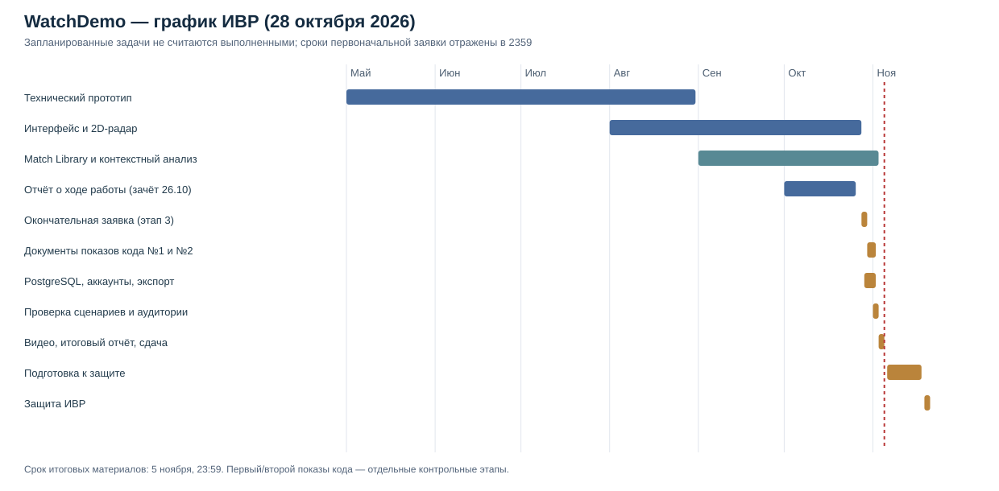

# Марко Петкович — WatchDemo

**Окончательная проектная заявка · 28 октября 2026**

### Группа: 11 - И - 4

**[ НАЗВАНИЕ ПРОЕКТА ]**

WatchDemo

**[ ПРОБЛЕМНОЕ ПОЛЕ ]**

В Counter-Strike 2 игрок может скачать demo-файл своего матча и самостоятельно разобрать игру. В demo хранится информация о действиях игроков, убийствах, передвижениях, гранатах, бомбе и других событиях. На практике полноценный разбор требует открыть запись матча, вручную перемещаться по раундам и искать важные ситуации. Для этого нужно потратить заметное время и уже понимать, на какие ошибки обращать внимание.

Существующие сервисы дают статистику, рейтинги, 2D-повторы и другие инструменты анализа, однако игроку всё равно бывает трудно быстро ответить на вопрос: какие ошибки в конкретном матче были наиболее важными и в каких именно моментах они произошли. Услуги тренера позволяют получить такой разбор, но требуют отдельного времени и денег.

Проблема проекта: игроку, который хочет улучшать свою игру, нужен быстрый способ загрузить demo-файл, получить основные показатели и небольшой список конкретных проблем с привязкой к раунду и моменту матча, чтобы затем самостоятельно проверить вывод на интерактивном радаре.

Для пилотной проверки проблемного поля я планирую провести количественный опрос примерно 8–12 игроков Counter-Strike 2 по 6–8 вопросам о практике просмотра demo, затратах времени на самостоятельный анализ, используемых сервисах и востребованности автоматического поиска игровых проблем. Дополнительно планируются около трёх качественных интервью с игроками разного уровня по 5–6 открытым вопросам о трудностях анализа и полезности предполагаемых функций. В итоговом отчёте будут представлены только реально полученные ответы, фактический объём выборки и ограничения такого исследования.

**[ ЗАКАЗЧИК / ПОТЕНЦИАЛЬНАЯ АУДИТОРИЯ ]**

Основная целевая аудитория WatchDemo — игроки Counter-Strike 2, которые регулярно играют соревновательные матчи и хотят улучшать собственную игру.

Можно выделить несколько групп:

* Игроки примерно 14–18 лет, которые играют Matchmaking, Premier или FACEIT, уже знают базовые механики игры, но не имеют опыта системного разбора demo.
* Игроки примерно 18–30 лет среднего и высокого любительского уровня, которые хотят прогрессировать, но не готовы после каждого матча полностью пересматривать запись самостоятельно.
* Игроки FACEIT среднего и высокого уровня, которым важны не только итоговые K/D и ADR, но и конкретные игровые ситуации: первые смерти, размены, позиционные решения, использование гранат и другие повторяющиеся ошибки.
* Небольшие любительские команды, которым нужен быстрый способ открыть матч, посмотреть раунд на 2D-радаре и обсудить найденную ситуацию.

На первом этапе проект ориентирован прежде всего на русскоязычных пользователей. Пол пользователя не является значимым критерием сегментации.

**[ АППАРАТНЫЕ / ПРОГРАММНЫЕ ТРЕБОВАНИЯ ]**

Клиентская часть WatchDemo является веб-приложением. Минимальная конфигурация компьютера, на которой должна корректно работать пользовательская часть:

* процессор: 64-битный двухъядерный процессор уровня Intel Core i3 / AMD Ryzen 3 или выше;
* оперативная память: от 8 ГБ;
* свободное место на диске: от 2 ГБ для временного хранения demo-файлов и загруженных данных;
* видеокарта: встроенная или дискретная с поддержкой современного браузерного рендеринга;
* операционная система: Windows 10 22H2 и выше; дополнительно планируется проверка на Windows 11;
* браузер: Google Chrome версии 120 и выше или другой Chromium-браузер с сопоставимой поддержкой Web API;
* подключение к интернету для загрузки demo-файла и получения результатов анализа.

Серверная часть должна запускаться на 64-битной системе Linux или Windows, иметь не менее 4 процессорных ядер, 8 ГБ оперативной памяти и не менее 10 ГБ свободного дискового пространства для временной обработки demo-файлов, базы данных и результатов анализа.

**[ ФУНКЦИОНАЛЬНЫЕ ТРЕБОВАНИЯ ]**

Программный продукт должен предоставлять следующие возможности:

* Пользователь может зарегистрироваться, войти в аккаунт, восстановить или изменить пароль, изменить основные данные профиля и получить доступ к ранее сохранённым результатам анализа.
* Пользователь может загрузить demo-файл Counter-Strike 2 формата .dem.
* Система проверяет загруженный файл и сообщает об ошибке, если файл невозможно обработать.
* Система извлекает из demo информацию об игроках, раундах, убийствах, передвижениях, гранатах, бомбе и других необходимых игровых событиях.
* Пользователь может выбрать игрока, для которого проводится персональный анализ.
* Система рассчитывает основные статистические показатели выбранного игрока, включая K/D, ADR, первые убийства/смерти и другие используемые в анализе показатели.
* Пользователь может открыть интерактивный 2D-радар и воспроизводить ход матча с позициями игроков и ключевыми событиями.
* Пользователь может работать с временной шкалой матча и переходить к выбранному раунду или моменту.
* Система автоматически обнаруживает ограниченный набор из 3–5 типов игровых проблем по заранее определённым алгоритмам.
* Система формирует список наиболее значимых обнаруженных проблем выбранного игрока.
* Для каждой обнаруженной проблемы система показывает раунд, время и краткое объяснение, после чего пользователь может перейти непосредственно к этому моменту на радаре.
* Система сохраняет данные о загруженном матче и сформированном отчёте в базе данных, чтобы пользователь мог открыть результат повторно.
* Пользователь может экспортировать основные результаты анализа и статистику матча в JSON-файл.

Основной пользовательский сценарий: вход в приложение → загрузка demo → обработка → выбор игрока → просмотр отчёта → переход от найденной проблемы к конкретному моменту матча на 2D-радаре.

**[ ПОХОЖИЕ / АНАЛОГИЧНЫЕ ПРОДУКТЫ ]**

* Leetify — сервис аналитики Counter-Strike, который рассчитывает большое количество статистических показателей и рейтингов, в том числе Aim, Utility и Positioning. Он хорошо подходит для длительного отслеживания статистики игрока. В WatchDemo основной акцент будет сделан не на большом количестве рейтингов и сравнении с общей базой игроков, а на коротком разборе конкретного загруженного demo-файла: найденная проблема должна быть связана с конкретным раундом и проверяемым моментом на радаре.
* SCOPE.GG — сервис с расширенной статистикой, поиском ошибок, историей матчей, 2D-повтором и другими функциями. Это крупный продукт с большим количеством возможностей. В рамках WatchDemo планируется более узкий сценарий: пользователь самостоятельно загружает demo, получает ограниченный набор автоматически найденных проблем и сразу переходит к доказательству каждой проблемы в конкретном моменте матча.
* CS Demo Manager — приложение для управления demo-файлами Counter-Strike. Оно умеет анализировать demo, показывать статистику, 2D-повторы, heatmap и экспортировать данные. Основная задача WatchDemo отличается тем, что продукт должен не только дать инструменты просмотра demo, но и автоматически отобрать несколько наиболее значимых проблем игрока и связать каждый вывод с моментом матча.
* Встроенный demo viewer Counter-Strike 2 позволяет полностью пересмотреть матч, переключаться между игроками и перемещаться по записи. При этом поиск собственных ошибок выполняется вручную: пользователь сам выбирает раунды и сам решает, какие действия были неправильными. WatchDemo должен сократить именно эту часть работы за счёт предварительного автоматического анализа.

**[ ИНСТРУМЕНТЫ РАЗРАБОТКИ, ИНФОРМАЦИЯ О БД ]**

* Python 3.13 — основная серверная логика и алгоритмы анализа.
* demoparser2 — извлечение игровых данных из demo-файлов Counter-Strike 2.
* FastAPI — backend и HTTP API.
* React / JavaScript — frontend и интерактивный интерфейс.
* HTML / CSS — вёрстка пользовательской части.
* PostgreSQL — реляционная база данных для хранения пользователей, информации о загруженных матчах, статуса обработки и сохранённых результатов анализа. PostgreSQL выбран потому, что данные проекта имеют понятные связи между пользователями, матчами и отчётами, а сама база подходит для серверного веб-приложения и не зависит от устройства пользователя.
* JSON — формат обмена данными между backend и frontend, а также один из форматов экспорта.
* Git и GitHub — контроль версий и хранение исходного кода.
* Visual Studio Code / PyCharm — среды разработки и отладки.
* Figma — проектирование интерфейса.

Demo-файлы используются как входные данные и могут храниться на сервере только временно на период обработки. Постоянно в базе сохраняются метаданные матча и данные, необходимые для повторного открытия отчёта.

**[ ЭТАПЫ РАЗРАБОТКИ ]**

* Май — август 2026: разработка технического прототипа: парсинг demo, извлечение игровых событий, базовая статистика, интерактивный 2D-радар и временная шкала.
* Сентябрь — октябрь 2026: развитие аналитического модуля, введение библиотеки структурированных данных матча (Match Library), учёт информации о противниках и контекста действий, проверка и исправление ложных срабатываний. Развитие интеграции backend, frontend и отчёта.
* Октябрь 2026: подготовка отчёта о ходе работы, пользовательских сценариев и прохождение второго этапа ИВР; 26 октября получен зачёт. Реализация и проверка Candidate Actions v1; 28 октября зафиксирован код на рабочей ветке GitHub.
* 28–30 октября 2026: подготовка и отправка окончательной заявки ИВР с актуализированным планом, пользовательскими сценариями и перечнем изменений.
* 29 октября — 2 ноября 2026: завершение серверного хранения (PostgreSQL), базовых функций аккаунта, повторного открытия отчёта и JSON-экспорта; интеграция доступного оформления интерфейса; завершение ограниченного набора проверяемых детекторов.
* 1–3 ноября 2026: тестирование пользовательских сценариев на demo-файлах, устранение критических ошибок и пилотное исследование целевой аудитории.
* 3–5 ноября 2026: фиксация версии ИВР, запись демонстрационного видео, завершение итогового отчёта и отправка итоговых материалов **не позднее 5 ноября, 23:59**.
* 6–18 ноября 2026: подготовка презентации, аргументации архитектурных решений и ответов на вопросы комиссии. Сданная версия ИВР остаётся неизменной.
* 19–21 ноября 2026: планируемая защита ИВР.

**Диаграмма Ганта:** 

Сроки и состояние конкретных задач отражают план на 28 октября 2026 года, а не подтверждение завершения ещё не реализованных функций.

**[ КЛЮЧЕВОЕ СОБЫТИЕ (ДЕЙСТВИЕ) В РАБОТЕ НАД ПРОЕКТОМ — ОПИСАНИЕ И ДАТА ]**

Октябрь 2026 года: переход к архитектуре анализа на основе единой библиотеки игровых данных Match Library.
В ходе разработки WatchDemo было принято решение организовать извлечённые из demo-файла сведения о матче в единую структуру данных, доступную разным аналитическим модулям. Это позволяет использовать согласованные данные об игроках, раундах, игровых событиях, состоянии экономики и информации о противниках при построении дальнейшего анализа.
Решение было принято после проверки первых алгоритмов: анализ отдельных событий без полноценного игрового контекста приводил к ложным срабатываниям. Создание Match Library позволило отделить получение и подготовку данных от алгоритмов интерпретации игровых ситуаций и заложило основу для дальнейшего развития контекстно-зависимого анализа игровых решений.

**[ ВОЗМОЖНЫЕ РИСКИ ]**

* Изменения формата demo-файлов или различия между demo из разных источников могут приводить к ошибкам парсинга. Для снижения риска анализ будет проверяться на матчах из нескольких источников, а некорректные входные данные будут обрабатываться отдельно.
* Алгоритм может ошибочно считать игровую ситуацию проблемой, если анализировать только одно событие без контекста. Поэтому правила должны учитывать время, позиции игроков, доступную игроку информацию и физическую достижимость областей карты; найденные ситуации будут вручную проверяться на реальных demo.
* Геометрический анализ карты и работа с navmesh могут оказаться слишком сложными для всех карт сразу. В таком случае сначала будет полностью поддержана ограниченная группа соревновательных карт, а расширение списка карт будет выполняться после стабилизации основных правил анализа.
* Обработка большого demo-файла может занимать слишком много времени или памяти. Для снижения риска тяжёлые промежуточные данные не будут передаваться одним большим JSON-файлом, а вычисления и структура результатов будут оптимизироваться отдельно.
* До защиты может не хватить времени на второстепенные функции. Поэтому для версии ИВР фиксируется минимальный объём: работающий веб-интерфейс, backend, база данных, загрузка demo, статистика, 2D-радар, 3–5 проверяемых правил анализа и переход от результата анализа к конкретному моменту матча. Более сложные функции будут отложены до завершения ИВР.
